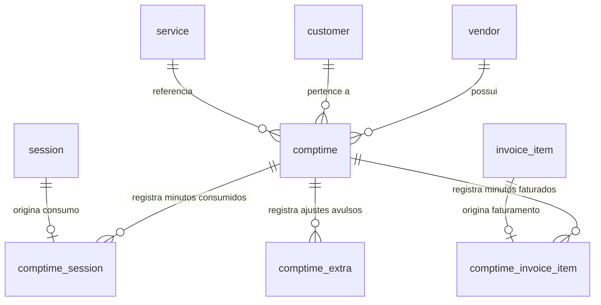
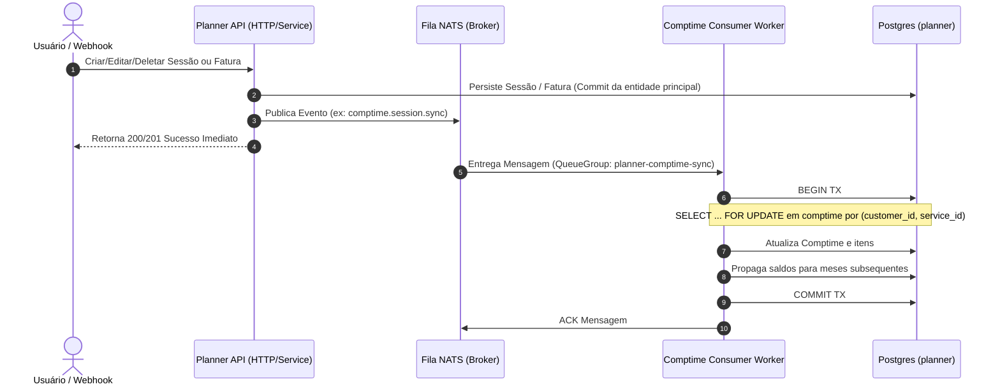

# Arquitetura do Banco de Horas (Comptime) - Subprojeto Planner

## 1. Visão Geral e Objetivos

Este documento descreve a arquitetura técnica, modelo de dados, fluxos de sincronização assíncrona, regras de concorrência e estratégias de propagação de saldo para o novo domínio de **Banco de Horas (`comptime`)** no subprojeto **Planner**, substituindo o antigo conceito de conciliação de faturas (`reconciliation`).

### 1.1 Motivação
No modelo anterior (`reconciliation`), o controle de horas consumidas vs. horas faturadas era acoplado diretamente aos itens da fatura por meio da coluna `realized_quantity` e da tabela `invoice_item_session`. Essa abordagem apresentava limitações:
- Impossibilidade de controlar saldos contínuos ao longo dos meses para um mesmo cliente e serviço.
- Dificuldade em lidar com horas extras, adiantamentos e créditos contratuais que ultrapassam a vigência de uma única fatura.
- Complexidade desnecessária no domínio de faturamento (`invoice`), que deve focar na cobrança e precificação (`quantity`).

### 1.2 Objetivos do Domínio Comptime
1. **Desacoplamento de Faturamento**: Remover `realized_quantity` de `invoice_item` e manter apenas `quantity`. O faturamento cuida exclusivamente da emissão de cobranças.
2. **Controle Temporal de Minutos**: O domínio `comptime` rastreia mensalmente os minutos faturados (`invoiced_minutes`), os minutos consumidos por sessões (`consumed_minutes`) e o saldo acumulado (`balance`) por combinação de `(vendor_id, customer_id, service_id, month)`.
3. **Propagação Automática de Saldo**: Qualquer alteração em um mês recalcula e propaga em cascata o saldo para os meses subsequentes, garantindo que consultas a qualquer mês reflitam o saldo acumulado histórico sem necessidade de agregação em tempo de leitura.
4. **Resiliência e Concorrência Segura**: Execução de mutações de saldo de forma assíncrona via mensageria (NATS), com bloqueio transacional por cliente/serviço para evitar condições de corrida (*race conditions*).
5. **Ressincronização Idempotente**: Fornecer um serviço/job de auditoria e recálculo em lote para corrigir ou reconstruir o banco de horas a partir do histórico de sessões e faturas.

---

## 2. Modelo de Dados

### 2.1 Esquema Relacional (`planner`)

O esquema do banco de horas é composto por 4 tabelas relacionais vinculadas por chaves estrangeiras:



#### Tabela `comptime`
Armazena o consolidado mensal do banco de horas por fornecedor, cliente e serviço.
- `id` (bigserial / serial, PK)
- `vendor_id` (bigint, FK `vendor.id` ON DELETE CASCADE)
- `customer_id` (bigint, FK `customer.id` ON DELETE CASCADE)
- `service_id` (bigint, FK `service.id` ON DELETE CASCADE)
- `month` (date, primeiro dia do mês correspondente: `YYYY-MM-01`)
- `invoiced_minutes` (int, total faturado no mês)
- `consumed_minutes` (int, total consumido no mês)
- `balance` (int, saldo acumulado até o final deste mês)
- `created_at`, `updated_at`, `deleted_at` (timestamps)
- **Constraint de Unicidade**: `UNIQUE (vendor_id, customer_id, service_id, month)` onde `deleted_at IS NULL`.

#### Tabela `comptime_session`
Rastreia a alocação de cada sessão individual no banco de horas.
- `id` (bigserial, PK)
- `comptime_id` (bigint, FK `comptime.id` ON DELETE CASCADE)
- `session_id` (bigint, FK `session.id` ON DELETE CASCADE)
- `month` (date, `YYYY-MM-01` da data da sessão)
- `consumed_minutes` (int, minutos da sessão contabilizados)
- `created_at`, `updated_at`, `deleted_at` (timestamps)
- **Constraint de Unicidade**: `UNIQUE (session_id)` onde `deleted_at IS NULL` para garantir que uma sessão ativa só seja contabilizada uma vez.

#### Tabela `comptime_invoice_item`
Rastreia a alocação de cada item de fatura no banco de horas.
- `id` (bigserial, PK)
- `comptime_id` (bigint, FK `comptime.id` ON DELETE CASCADE)
- `invoice_item_id` (bigint, FK `invoice_item.id` ON DELETE CASCADE)
- `month` (date, `YYYY-MM-01` do `invoice.period_start`)
- `invoiced_minutes` (int, `invoice_item.quantity * service.session_minutes`)
- `created_at`, `updated_at`, `deleted_at` (timestamps)
- **Constraint de Unicidade**: `UNIQUE (invoice_item_id)` onde `deleted_at IS NULL`.

#### Tabela `comptime_extra`
Permite ajustes manuais, concessão de horas bônus ou descontos administrativos.
- `id` (bigserial, PK)
- `comptime_id` (bigint, FK `comptime.id` ON DELETE CASCADE)
- `month` (date)
- `invoiced_minutes` (int, minutos adicionados ao crédito)
- `consumed_minutes` (int, minutos debitados avulsos)
- `created_at`, `updated_at`, `deleted_at` (timestamps)

---

## 3. Regras de Negócio e Cálculos

### 3.1 Normalização Temporal (`month`)
Todas as datas de referência são truncadas para o primeiro dia do mês (`YYYY-MM-01` 00:00:00 UTC/Local):
- Para sessões: `month = date_trunc('month', session.session_date)`
- Para faturas: `month = date_trunc('month', invoice.period_start)`

### 3.2 Regra de Sessões
1. **Criação de Sessão**:
   - Localiza ou cria o registro `comptime` para `(vendor_id, customer_id, service_id, month)`.
   - Verifica duplicidade em `comptime_session` com `deleted_at IS NULL`.
   - Se `session.status == "cancelada_nao_cobrar"`:
     - `consumed_minutes = 0` (não debita banco de horas).
   - Caso contrário:
     - `consumed_minutes = session.session_minutes`.
   - Incrementa `comptime.consumed_minutes += consumed_minutes`.
   - Recalcula saldo do mês e propaga para meses futuros.
2. **Exclusão de Sessão (Soft Delete)**:
   - Localiza `comptime_session` ativa correspondente.
   - Subtrai `comptime.consumed_minutes -= comptime_session.consumed_minutes`.
   - Marca `deleted_at = now()` em `comptime_session`.
   - Recalcula saldo do mês e propaga para meses futuros.
3. **Atualização de Sessão**:
   - Calcula a diferença entre os novos minutos efetivos e os minutos anteriores:
     $$\Delta = \text{session\_minutes\_novo} - \text{comptime\_session.consumed\_minutes}$$
     (se `status == "cancelada_nao_cobrar"`, minutos novos = 0).
   - Atualiza `comptime.consumed_minutes += \Delta`.
   - Atualiza `comptime_session.consumed_minutes`.
   - Recalcula saldo do mês e propaga para meses futuros.

### 3.3 Regra de Faturas (`invoice_item`)
1. **Criação de Item de Fatura**:
   - Minutos faturados gerados:
     $$\text{invoiced\_minutes} = \text{invoice\_item.quantity} \times \text{service.session\_minutes}$$
   - Localiza ou cria `comptime` para o mês de `invoice.period_start`.
   - Cria linha em `comptime_invoice_item`.
   - Incrementa `comptime.invoiced_minutes += invoiced_minutes`.
   - Recalcula saldo do mês e propaga para meses futuros.
2. **Exclusão de Item ou Fatura Inteira**:
   - Para cada item vinculado, localiza `comptime_invoice_item`.
   - Subtrai `comptime.invoiced_minutes -= comptime_invoice_item.invoiced_minutes`.
   - Marca `deleted_at = now()`.
   - Recalcula saldo e propaga.
3. **Atualização de Item de Fatura**:
   - Calcula $\Delta = \text{novo\_invoiced\_minutes} - \text{comptime\_invoice\_item.invoiced\_minutes}$.
   - Atualiza `comptime.invoiced_minutes += \Delta`.
   - Atualiza `comptime_invoice_item.invoiced_minutes`.
   - Recalcula saldo e propaga.

### 3.4 Regra de Propagação em Cascata do Saldo (`balance`)
O saldo de um mês $m$ é calculado a partir do saldo final do mês anterior $m-1$ somado aos créditos e subtraído dos consumos do mês atual:

$$\text{balance}_m = \text{balance}_{m-1} + \text{invoiced\_minutes}_m - \text{consumed\_minutes}_m$$

Quando ocorre qualquer mutação em um mês $M$:
1. O saldo do mês $M$ é atualizado com base no mês anterior $M-1$ (se existir):
   $$\text{balance}_M = (\text{balance}_{M-1} \text{ ou } 0) + \text{invoiced\_minutes}_M - \text{consumed\_minutes}_M$$
2. Todos os registros `comptime` com mesmo `(customer_id, service_id)` com $\text{month} > M$, ordenados por $\text{month ASC}$, são recalculados sequencialmente:
   $$\text{balance}_{k} = \text{balance}_{k-1} + \text{invoiced\_minutes}_{k} - \text{consumed\_minutes}_{k}$$
3. Desta forma, a consulta do saldo em qualquer mês é $O(1)$, sem agregação em tempo de leitura.

---

## 4. Arquitetura de Sincronização, Mensageria e Concorrência

### 4.1 Desafio da Concorrência
Como a atualização do banco de horas envolve múltiplas linhas e propagação temporal, se duas requisições simultâneas atualizarem sessões ou faturas do mesmo cliente/serviço (ex: webhook de faturamento e inclusão de sessão pelo recepcionista), pode ocorrer uma condição de corrida onde o saldo propagado sobrescreva o outro de forma incorreta (*lost update*).

### 4.2 Estratégia de Isolamento e Fila
Para garantir integridade absoluta e desacoplamento, adota-se um padrão híbrido robusto:



#### NATS Subjects
- `planner.comptime.sync.session`: Payload com `action` (`create`, `update`, `delete`), `session_id`, `vendor_id`.
- `planner.comptime.sync.invoice`: Payload com `action` (`create`, `update`, `delete`), `invoice_id`, `invoice_item_id`, `vendor_id`.

#### Lock Pessimista por `(customer_id, service_id)`
Dentro do worker de processamento (ou caso o NATS esteja desabilitado em modo síncrono/fallback):
- É obtido um lock transacional exclusivo no banco de dados para a tupla `(customer_id, service_id)` através de:
  ```sql
  SELECT pg_advisory_xact_lock(hashtext('comptime_' || customer_id || '_' || service_id));
  ```
- Isso garante que, mesmo com múltiplos workers consumindo mensagens paralelamente para clientes diferentes, atualizações para o **mesmo cliente e serviço** sejam estritamente serializadas, eliminando qualquer risco de race condition no saldo propagado.

---

## 5. Serviço e Job de Ressincronização

Para casos de manutenção, importação legada ou auditoria de integridade:
- **Entrada do Job**:
  - `vendor_id`: identificador do fornecedor (default = 1).
  - `start_date`: data inicial do período.
  - `end_date`: data final do período.
  - `data_type`: `"session"`, `"invoice"` ou `"all"`.
- **Funcionamento**:
  1. Varre todas as sessões e faturas existentes no período com `deleted_at IS NULL`.
  2. Garante a existência do registro `comptime` pai para cada mês encontrado.
  3. Reconcilia as entradas em `comptime_session` e `comptime_invoice_item`, restaurando integridade.
  4. Executa a rotina de reordenação e recálculo de saldo em cascata desde o primeiro mês afetado até o mês mais recente.
  5. Retorna estatísticas de execução (total de registros processados, minutos corrigidos, tempo de execução).

---

## 6. Interface Web e HTMX

1. **Remoção de Conciliação**:
   - Limpeza nos templates `sessions.html` e `invoicing.html` das colunas, botões e atributos HTMX de conciliação (`hx-post="/reconciliation/..."`).
   - Remoção de badges de conciliação e unificação da quantidade em faturas para apenas `quantity`.
2. **Nova Tela / View de Banco de Horas (`/comptime`)**:
   - Listagem com:
     - Mês de Referência (`MM/YYYY`).
     - Cliente.
     - Serviço.
     - Minutos Faturados (`invoiced_minutes`).
     - Minutos Consumidos (`consumed_minutes`).
     - Saldo Atual (`balance`, destacado com cores: positivo em verde, negativo em vermelho).
   - Filtros:
     - Mês Inicial (`start_month`).
     - Mês Final (`end_month`).
     - Cliente (`customer_id`).
     - Serviço (`service_id`).
   - Ordenação padrão: Mês decrescente (`DESC`) e Nome do Cliente crescente (`ASC`).
   - Botão e Modal de Ressincronização:
     - Formulário HTMX disparando POST para `/comptime/resync` com feedback visual de progresso via spinner/toast.
